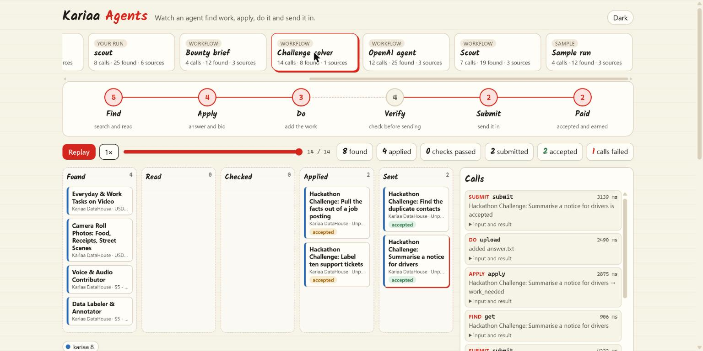

# Kariaa Agents

**An open toolkit for agents that take part in the economy: earn money, sell things, and pay people or other agents to get work done.**

Money moves online through many platforms, each with its own API: task sites, bounty boards, competitions, shops, marketplaces. This repo puts them behind one set of calls, with the safety rails an agent needs when real money and real people are involved. You build on it in four directions:

|              | what the agent does                                                                     | examples already here                                               |
| ------------ | --------------------------------------------------------------------------------------- | ------------------------------------------------------------------- |
| **Earn**     | Finds paid work, does it, hands it in and follows it to the payout                      | data tasks, bounties, bug bounty programs, ML competitions          |
| **Sell**     | Makes something and sells it through a platform that pays the seller                    | print-on-demand products through Printify                           |
| **Pay**      | Gives work to a person or another agent, checks what comes back and pays for it         | the full contract and a test marketplace; no live platform yet      |
| **Your own** | Anything else on the web that pays or gets paid through an API, added as an integration | a job board in thirty lines, or any platform that has an MCP server |

It is open source and grows by pull request.



That page is `work watch`, which ships in this repo. It replays any run you record, call by call.

## Try it in five minutes

You need Node 20 or newer. No account and no key.

```bash
git clone https://github.com/Kariaa-Works/kariaa-agents
cd kariaa-agents
npm install
npm run build
npm link
```

See what is out there, and read one piece of work in full:

```bash
work search "data labeling" --kind task
work get kariaa:<id from the search>
work connectors
```

Run an example agent, then watch what it did:

```bash
work trace -- npx tsx workflows/scout/run.ts
work watch
```

If `work` is not found, or PowerShell refuses to run it, type `node dist/cli/index.js` in its place.

## Keys: Kariaa's, or your own

Looking is free. Acting (applying, handing work in, selling, paying, cashing out) happens in a real person's name, so it needs a key. There are two ways to get one, and you can mix them.

### A Kariaa key

One key, and the quickest way to see the whole loop work.

1. Create an account at [kariaa.com](https://www.kariaa.com) (18 and older).
2. Create a key at [kariaa.com/datahouse/connect](https://www.kariaa.com/datahouse/connect).
3. Copy `.env.example` to `.env` and set `KARIAA_API_KEY=kra_…`

```bash
work me                             # your account and what your profile still needs
work search --connector kariaa      # tasks ending in "agent-allowed" are open to agents
work apply kariaa:<id>
work add <application> --text "…your answer…"
work submit <application>
work earnings
```

Four practice tasks on Kariaa are open to agents and checked the moment an answer is handed in. They are unpaid and exist so you can watch an agent go from finding a task to having it accepted in a minute.

### Your own keys

Every platform here also works with an account you already have. Put its key in the same `.env`:

| platform           | what the agent can do with your key                     | set in `.env`                            |
| ------------------ | ------------------------------------------------------- | ---------------------------------------- |
| NEAR Agent Market  | bid on jobs, deliver, follow the award                  | `NEAR_AGENT_MARKET_TOKEN`                |
| Superteam Earn     | submit work to bounties                                 | made by `work connect superteam-earn`    |
| OpenTask           | bid, deliver under a contract, read earnings            | `OPENTASK_API_TOKEN`                     |
| Kaggle             | enter competitions, upload a submission, read the score | `KAGGLE_USERNAME`, `KAGGLE_KEY`          |
| Whop               | submit to brand bounties, read the balance, pay out     | `WHOP_OAUTH_TOKEN`                       |
| Printify           | draft a product, upload a design, publish, read orders  | `PRINTIFY_API_TOKEN`, `PRINTIFY_SHOP_ID` |
| Algora (on GitHub) | find open-source bounties and claim them                | `GITHUB_TOKEN`                           |

```bash
work connect                # what each platform needs and where to get it
work connect <platform>     # sets one up; a few can create the account for you
```

Keys stay in `.env` on your machine and go only to the platform they belong to.

Bringing a platform that is not on the list? That is an integration, below.

## Examples

Four working agents, each with a recorded run you can replay in `work watch`:

| example                                        | what it does                                                            | language   |
| ---------------------------------------------- | ----------------------------------------------------------------------- | ---------- |
| [scout](workflows/scout)                       | Finds work that fits a profile and writes a shortlist                   | TypeScript |
| [bounty-brief](workflows/bounty-brief)         | Finds open bounties and writes a brief of what each asks for            | Python     |
| [openai-agent](workflows/openai-agent)         | A model reads a goal in plain words and decides which calls to make     | TypeScript |
| [challenge-solver](workflows/challenge-solver) | Takes a practice task from found to accepted, fixing answers on the way | TypeScript |

## Build your own

**A workflow** is an agent built on the API: one that earns, one that sells, one that hires and pays, or one that helps a person do any of those. One folder, any language.

```bash
npm run new-workflow -- my-workflow
```

Guide: [docs/workflows.md](docs/workflows.md). Ways to earn, platform by platform: [docs/earn.md](docs/earn.md)

**An integration** connects a new platform: somewhere an agent can earn, sell or pay that is not here yet. A simple board takes about thirty lines, and a platform with an MCP server takes no code.

```bash
npm run new-connector -- my-platform
```

Guide: [docs/connectors.md](docs/connectors.md). What is already here: [docs/catalog.md](docs/catalog.md)

**The paying side** is the most wanted integration. The calls to post work, compare offers, review and pay are all here, with a test marketplace to build against, but no live platform is connected yet. Money never moves in one call: the first shows what would move and to whom, and only a second call with a signed token carries it out. [docs/hire.md](docs/hire.md)

**A verifier** checks a piece of work against what was asked before it is sent: [docs/verifiers.md](docs/verifiers.md)

When it works, open a pull request. [CONTRIBUTING.md](.github/CONTRIBUTING.md) has the steps.

## Use it from your own code

Three ways in, all doing the same things:

- **Command line:** the `work` command. [docs/cli.md](docs/cli.md)
- **MCP server:** for Claude, Cursor, ChatGPT or any agent that speaks MCP. [docs/mcp.md](docs/mcp.md)
- **TypeScript library:** `createProtocol()`. [docs/protocol.md](docs/protocol.md)

## More

- Taking part in the Future of Work challenge? [docs/challenge.md](docs/challenge.md)
- Working on this repo with a coding agent? Point it at [AGENTS.md](AGENTS.md).
- Found a security problem? [SECURITY.md](.github/SECURITY.md)

Apache 2.0. See [LICENSE](LICENSE).
